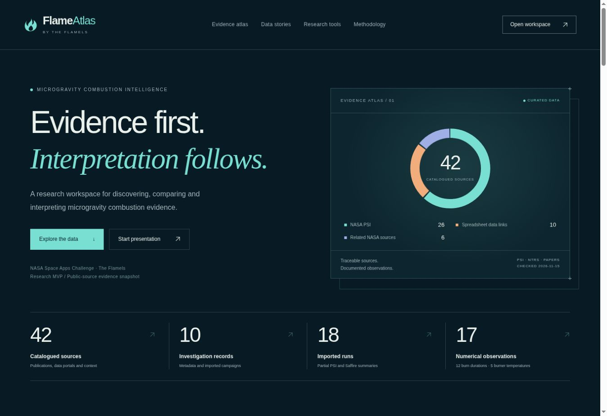

# FlameAtlas — The Flamels

The Flamels research product includes a public evidence atlas and an extended scientific application. The public atlas contains ten investigation records, 42 public sources, 18 imported runs and 17 numerical observations. The extended edition retains the complete pinned SpaceFire reference application in a separate runtime and catalogue.

## Extended research platform — The Flamels edition

The complete SpaceFire-derived research platform now has its own FlameAtlas identity, five conceptual 3D studios, scientific analysis, collection browsing, condition similarity, guided demo and cited Research Copilot. The installer clones the complete pinned reference repository, verifies source hashes and applies the reviewed edition patch; the original MVP remains available.

### Quick start (Windows)

```bat
git clone https://github.com/tun539/the-flamels.git C:\Flamels
cd /d C:\Flamels
setup.cmd
launch.cmd
```

Open `http://127.0.0.1:3000`. No model API key is required for evidence retrieval. [Full platform setup, features, attribution and deployment](research-platform/README.md).

The adaptation retains attribution to [COngtuthien/SpaceFire-AI](https://github.com/COngtuthien/SpaceFire-AI). Upstream supplies no license file; no new license is assigned to its materials. The original NASA files are preserved.

## Live web app

[Open FlameAtlas — interactive research app](https://flameatlas-evidence-studio.kh-ng-gian-l-5063.chatgpt.site)

Explore the evidence, compare investigations, evaluate research scenarios and export cited results in the deployed app. The site uses a versioned repository snapshot.

## Run

### Open on GitHub without installing locally

[Open FlameAtlas in GitHub Codespaces](https://codespaces.new/tun539/the-flamels?quickstart=1)

Create a Codespace on `main`. Setup installs Python/Node dependencies and builds the MVP; startup launches both servers automatically. Open **Ports → 3000 → Open in Browser** when ready. Keep port visibility private: the app does not provide multi-user authentication. Codespaces availability and usage depend on your GitHub account; stop the Codespace when finished. This is an interactive development runtime, not permanent public hosting.

If startup fails, inspect `.runtime/mvp.log`. Run `.venv/bin/python scripts/run_mvp.py --background` to start again. Data stays in that Codespace's `data/flameatlas.db`; export it before deleting the Codespace.

### Docker

```sh
cp .env.example .env
docker compose up --build
```

Open http://localhost:3000. API documentation: http://localhost:8000/docs. SQLite persists in the Docker volume. Services bind to localhost; this is a local research workspace, not an authenticated multi-user deployment.

## Local development

```sh
python -m venv .venv
. .venv/bin/activate
pip install -r backend/requirements.txt
python scripts/seed.py
uvicorn backend.app.main:app --reload
```

In a second terminal:

```sh
cd frontend
npm ci
npm run dev
```

## Product presentation

Open **Presentation ↗** in the workspace header or visit `/present` for the product showcase. It includes source composition, campaign-specific observation plots, a coverage matrix, investigation comparison, scenario relevance intervals, cited evidence search, presentation controls and print/PDF styles. The English showcase works without the API using a versioned repository snapshot. See [presentation guide](docs/presentation.md).



## Source library and reading

Open **Library** for the ten-column source table: 10 public data links, 26 PSI accessions and six related NASA resources (42 total). Select **Read** for summaries, cited findings and limitations. **Coverage** shows which experimental conditions are actually present. See [new sources and Codespace update](docs/source-expansion.md), [delivery status](docs/completion-status.md) and [testing](docs/testing.md).

## Features

- SQLite and FTS5 study catalogue; study detail and source links.
- Compare 2–4 investigations with explicit missing values.
- Scenario evaluation with conservative relevance bounds, a readiness brief, and a source-linked oxygen–pressure gap map.
- Filterable coverage export and a campaign planner for prioritizing research questions.
- Evidence retrieval assistant without API keys, with source summaries and locators.
- Validated JSON/CSV import, preview and explicit commit; duplicate detection and import checksums.
- JSON exports can be imported directly; canonical values are not converted a second time. Original units remain attached to each run.
- Comparison includes individual run conditions and flags different measurement quantities, units or methods.
- CSV, JSON and printable HTML exports including provenance and scenario ranking.
- Responsive interface, loading/error/empty states and retry.

## Data and scientific scope

Six overview seed records verify metadata from NASA's Combustion Science overview. CFI-G adds five partial PSI-159 rows and ten observations. Saffire I–III add thirteen sample runs and seven numerical burn durations. The complete preserved Saffire summary tables also contain notes, pre-test rows and blank rows that are excluded from run counts. Editorial theme labels are not experimental findings. Imported records are unverified until independently reviewed.

Relevance is not fire hazard. Unknown metadata contributes an interval, not a positive match. No quantitative combustion predictions, certified safety recommendations, or partial-gravity extrapolation are provided.

The assistant defaults to deterministic retrieval. Optional server-side OpenAI evidence selection and cached embedding reranking are configured in .env.example. Measurement plots and import field/unit mapping are available for supplied data. Shared cloud deployment requires authentication and deployment hardening.

## Tests

```sh
python -m unittest discover -s backend/tests
cd frontend
npm run typecheck
npm run build
```

See [18-source PSI batch and Saffire import](docs/psi-batch-two.md), [PSI accessions and partial import](docs/psi-accessions.md), [requirements](docs/product-requirements.txt), [methodology](docs/methodology.md), [data dictionary](docs/data-dictionary.md), [demo](docs/demo.md), and [remaining work](docs/roadmap.md).

Research support tool. Not a certified fire safety assessment.

## Research Studio

Open `/studio` for a scenario brief, fuel-scoped studies and comparison, the evidence gap map, cited search, model review and the 3D lab launcher. The core studio uses the offline snapshot and works without a model key.

The example `/studio?env=airliner&fuel=solid#studies` opens the solid-material collection with an illustrative normal-gravity airliner scenario (21% oxygen and 78 kPa). This example describes the selected research inputs. Use **Share research view** to send a link that retains the evaluated scenario, filters and active tool.

The extended platform runs separately. To open its interactive scenes and model workbench directly from the studio, set `NEXT_PUBLIC_FLAMEATLAS_PLATFORM_URL` in the core frontend environment before building. For example, launch the extended edition at `http://127.0.0.1:3200` using `python scripts/research_platform.py start --frontend-port 3200 --api-port 8200` and set the variable to that origin. Without an origin, the studio provides setup links. Ask evidence also supports optional English dictation on browsers with speech recognition. Edit the transcript before submitting.
