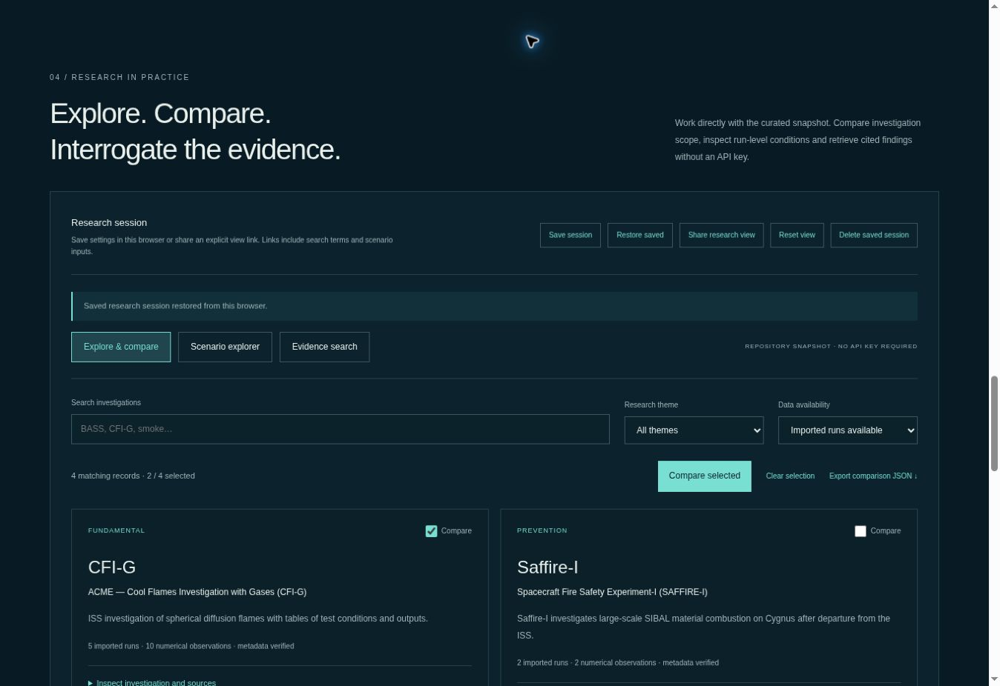

# FlameAtlas presentation

Live showcase: https://flameatlas-evidence-studio.kh-ng-gian-l-5063.chatgpt.site (access follows the Site’s current sharing settings).

Open `/present` in the running MVP. The workspace header links to this route. It has no API dependency: the presentation uses a curated, versioned snapshot so it can also run as a standalone static site.

## Demo sequence

1. Start with the source composition and four inventory counts: 42 public resources, 10 investigation records, 18 imported runs, 17 numerical observations. They describe different entities and must not be added together.
2. Choose Saffire-II to inspect five numeric burn durations among nine samples. Select sample 2-9 to inspect its source locator. Its material remains unreported. The other four samples retain the qualitative value `Insignificant` in the table.
3. Choose CFI-G and switch to peak burner temperature. The five observations are in degrees Celsius; these are burner temperatures, not flame temperatures. Each run retains its configuration and provenance. Selecting a point reveals the original source-row conditions, including mass flow, termination type and comments where reported.
4. Choose Saffire-III to demonstrate the explicit missing-output state. No zero or interpolated observation replaces a missing value.
5. Read the coverage matrix. Its numerator is the number of imported runs with a non-null standardized field. Its denominator is the imported runs in that campaign, not the entire NASA archive.
6. Open Research tools. Filter investigations by theme and run availability, select 2–4 records and compare metadata and actual run conditions. Export the selected records as JSON.
7. Define an editable hypothetical scenario. Inspect conservative relevance intervals, component weights, missing conditions and source references. Export the scenario and methodology.
8. Retrieve cited summaries and findings using Evidence search, then inspect primary sources and applicability limits. Context-only sources are excluded.
9. Use the seven-section presentation controller (arrow keys, Page Up/Down, Escape), download observation CSV or the full snapshot, or print/save PDF.

## Scientific chart rules

- Plot observations within one campaign and one quantity. Do not join categorical samples into a time series or fit an unsupported trend.
- Require matching units and measurement methods before displaying the shared plot. Different configurations are preserved; differences in values are not presented as causal effects.
- Preserve units, source locators, unrounded values, missing conditions and qualitative outputs. The display rounds labels to three decimals, while the selected-point detail, table and download retain source precision.
- Do not display uncertainty bars when no measurement uncertainty was reported. No exact cabin oxygen is inferred from a range, approximate value, or burner mixture.
- Coverage is data availability, not confidence or fire hazard. No Moon/Mars extrapolation or certified safety assessment is implied.

## Refresh the snapshot

```sh
python scripts/build_presentation_data.py
python scripts/build_presentation_data.py --check
cd frontend
npm run typecheck
npm run build
npm run test:e2e
```

The generator reads `data/seed.json`, `data/psi-seed.json` and `data/resources.json` and `data/ranking-methodology.json`, excludes synthetic studies, calculates counts and hashes the exact source bytes with SHA-256. It includes source-check dates and a schema version. CI rejects a stale snapshot. The presentation does not automatically reflect imports made into a running workspace database.

## Standalone delivery

The standalone presentation uses the same `Presentation.tsx`, CSS module and generated JSON, and the ResearchTools, ScenarioExplorer and deterministic helper modules, with a root page that supplies the existing Codespace URL as `workspaceUrl`. It exports with Next.js `output: "export"`. The research workspace itself remains the full Next.js/FastAPI application. A presentation-site build does not deploy or authenticate that backend.

Site project: `appgprj_6afa4250b3548191808a611678e1e4a8`. Keep this identity for future updates. Existing Site access settings must be preserved.

## Language and reproducibility

The UI and curated editorial content are English. Translation does not alter original source rows, numerical observations, units, locators or raw-source checksums. The full workspace upgrades only checksum-matching prior seed records; user-edited records are preserved.

Scenario weights, tolerances and version come from one shared methodology file. The browser engine is checked against backend results for missing and mismatched conditions. Intervals describe unknown metadata, not statistical confidence or fire hazard.

## Saved research sessions and view links

Research tools now preserve exploration filters, up to four selected investigations, the comparison view, evidence queries, draft scenario inputs and the last evaluated scenario. Use **Save session** to retain them in the current browser; saved settings restore on the next visit. **Restore saved** reloads the saved state, **Reset view** resets current settings, and **Delete saved session** removes the browser copy while retaining the current view.

**Share research view** generates an explicit URL containing research settings. Search terms and scenario inputs are included; source documents, measurements and computed rankings are not embedded. Recipients use the Site’s existing access permissions. Clipboard failures leave a selectable link. Browser data and URL parameters are validated, unknown fields are discarded, and results are recomputed from the current evidence snapshot. Older snapshots are identified during restore.

Changing scenario inputs leaves the last evaluated results visible with an explicit warning. Evaluate again to update those results. Switching tools preserves draft and evaluated scenarios.


